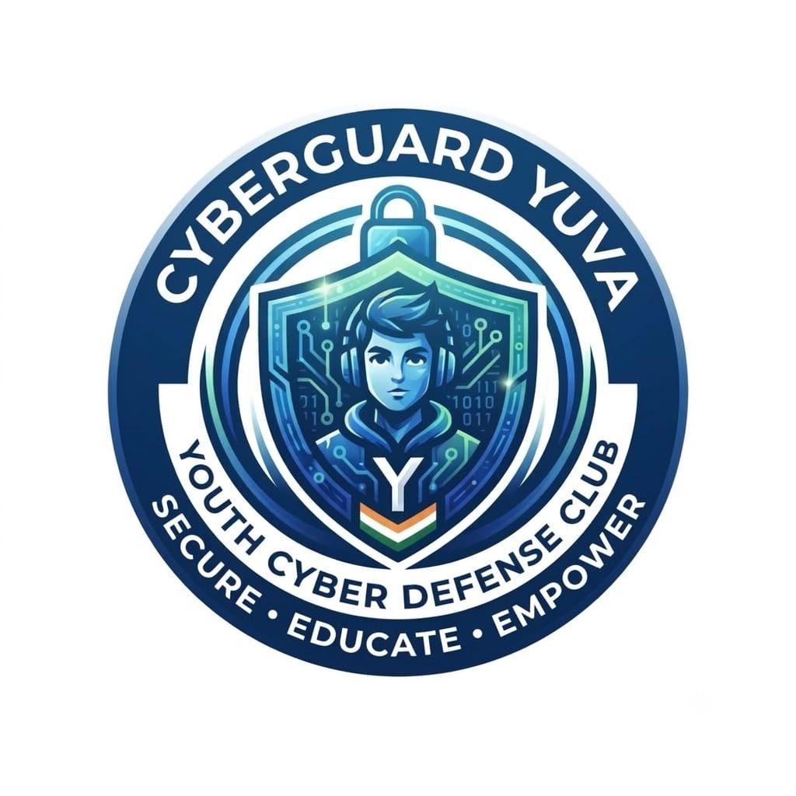
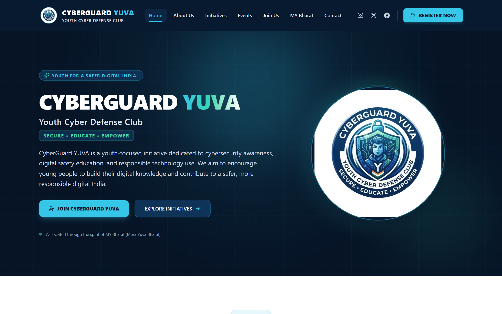
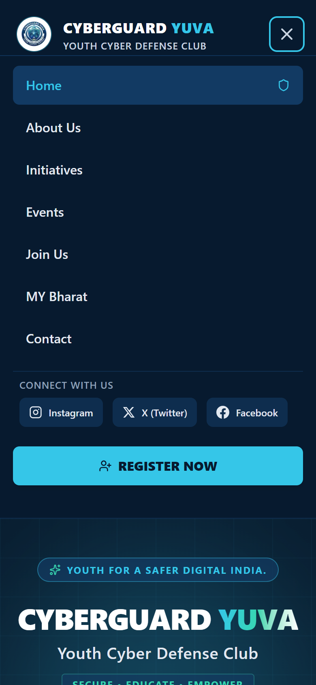
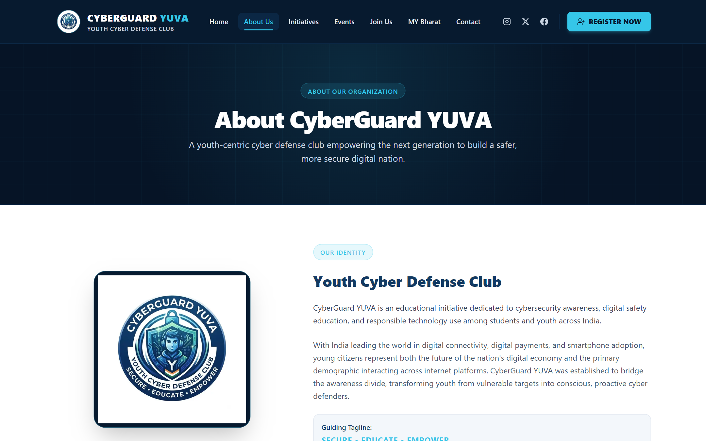
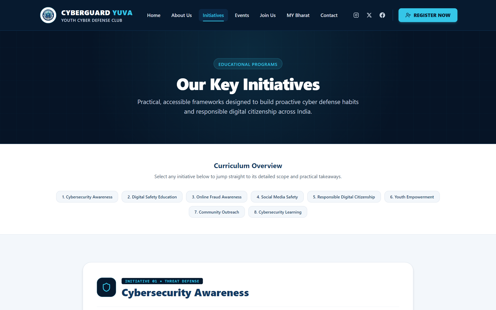
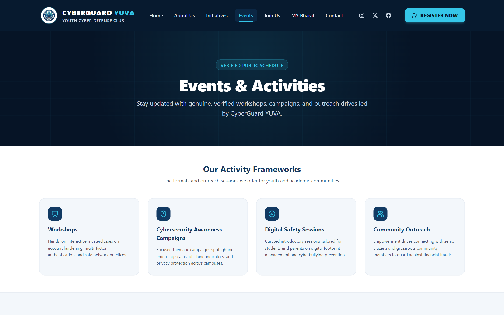
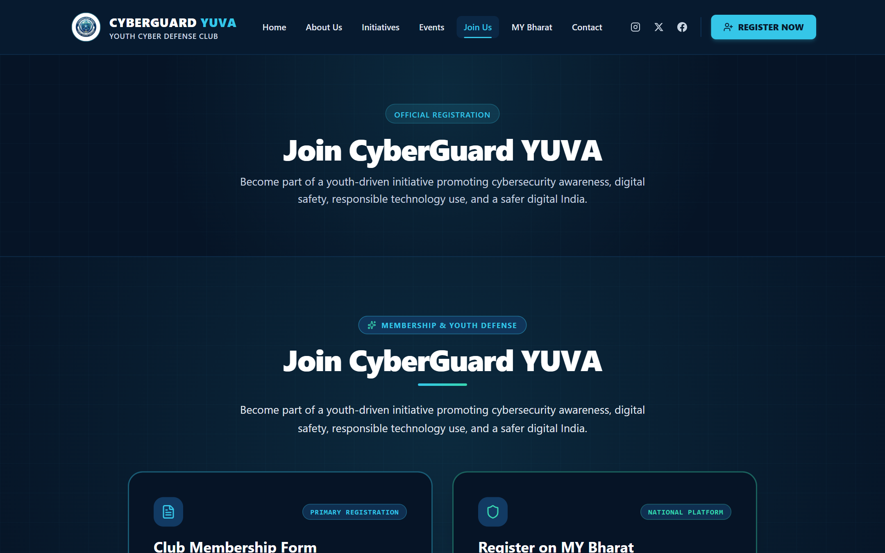
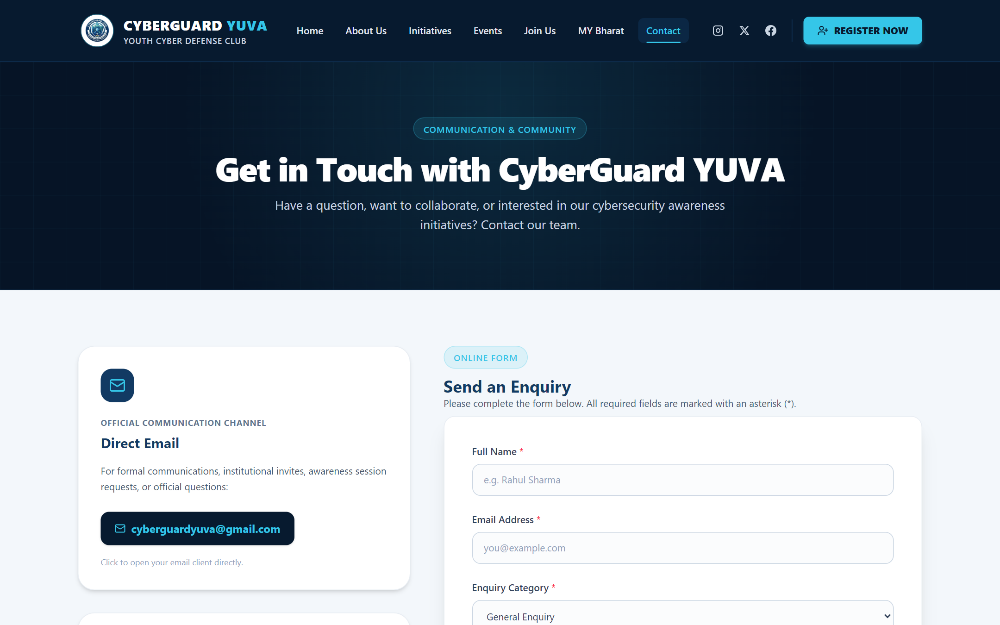
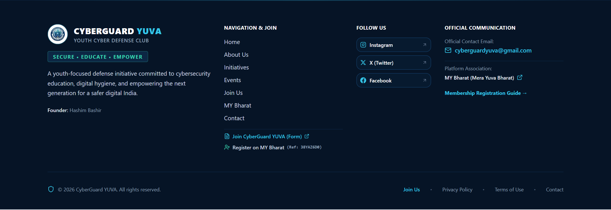

# CyberGuard YUVA — Youth Cyber Defense Club

<p align="center">
  
</p>

<p align="center">
  <strong>SECURE • EDUCATE • EMPOWER</strong><br>
  <em>Youth for a Safer Digital India.</em>
</p>

<p align="center">
  <a href="#website-preview"></a>
  <a href="#website-preview"></a>
  <a href="#website-preview"></a>
  <a href="#website-preview"></a>
  <a href="#official-registration--links"></a>
</p>

---

## Project Overview

**CyberGuard YUVA** is an educational, youth-driven cyber defense initiative dedicated to cybersecurity awareness, practical digital safety education, and responsible technology usage across India.

With India leading global frontiers in digital connectivity, digital payments, and smartphone adoption, young citizens represent both the pulse of the digital economy and the demographic most vulnerable to cyber fraud, identity theft, social engineering, and unauthorized data harvesting. CyberGuard YUVA bridges this critical divide by transforming young users into conscious, proactive digital guardians.

The platform is engineered using modern web technologies—**Next.js 16 (App Router)**, **React 19**, **TypeScript**, and **Tailwind CSS v4**—delivering a high-performance, mobile-responsive, accessible, and cyber-themed digital hub.

- **Official Tagline:** `SECURE • EDUCATE • EMPOWER`
- **Brand Message:** `Youth for a Safer Digital India.`
- **Founder:** Hashim Bashir
- **Official Contact Email:** `cyberguardyuva@gmail.com`
- **Platform Association:** MY Bharat (Mera Yuva Bharat)
- **MY Bharat Referral Code:** `38YAZ6D0`

---

## Website Preview

The live interface provides an intuitive experience with a custom dark cyber defense theme, cyan-accented cyber-circuit aesthetics, and instant access to membership enrollment and educational curriculum.



---

## Full-Page Homepage Preview

The homepage showcases the complete end-to-end journey—from the primary hero banner and core focus areas to guiding principles, dual registration paths, verified upcoming activity schedules, and platform credentials.


---

## Website Screenshots

Below are screenshots captured directly from the running application, showcasing the site's modular pages, responsive layouts, and interactive components.

### 1. Responsive Mobile Layout & Navigation Menu
Optimized for smartphones and small displays, featuring a slide-in navigation drawer, route status indicators, quick social media links, and a prominent registration call to action.



### 2. Core Educational & Information Pages

#### About Us (`/about`)
Outlines the organization's mission, vision, core values (**Security**, **Education**, **Responsibility**, **Empowerment**, **Community**), leadership under Founder **Hashim Bashir**, and the guiding principles for youth defense.



#### Initiatives & Curriculum Overview (`/initiatives`)
Details 8 structured awareness modules covering threat defense, everyday digital hygiene, online fraud, social media safety, ethical digital citizenship, youth leadership, grassroots outreach, and cybersecurity learning.



#### Events & Activities Tracking (`/events`)
Features verified schedule tracking designed with empty-state protection against unverified announcements, along with session request pipelines for schools, colleges, and community groups.



### 3. Membership Onboarding & Communications

#### Join Us / Membership Registration (`/join`)
A multi-path onboarding page featuring a 4-step registration guide, direct access to the official Google Form application, and guided registration through the national **Mera Yuva Bharat (MY Bharat)** portal with referral code `38YAZ6D0`.



#### Contact & Enquiry Channel (`/contact`)
An interactive enquiry system with category-specific routing (Collaboration, Workshop Requests, General Enquiries), client-side validation, official direct email contact (`cyberguardyuva@gmail.com`), and verified social channels.



#### Platform Footer & Association (`Footer`)
Global footer incorporating brand identifiers, quick navigation, social channels, platform associations, copyright safeguards, and direct links to Privacy Policy and Terms of Use.



---

## Implemented Features

- **App Router Architecture:** Built with Next.js 16 App Router for optimized static pre-rendering, dynamic server handling, and streamlined layout hierarchies.
- **Dual-Path Registration Pipeline:**
  - Direct CyberGuard YUVA membership interest registration via embedded and direct Google Forms.
  - Platform association with Mera Yuva Bharat (MY Bharat) utilizing referral code `38YAZ6D0`.
- **Comprehensive 8-Part Cybersecurity Curriculum:** Dedicated syllabus modules addressing real-world cyber risks, financial frauds, social media hygiene, and strong authentication protocols.
- **Verified Event Verification System:** Safeguards users from fake announcements by publishing strictly verified public schedules and offering formal institutional workshop request mechanisms.
- **Interactive Contact Form with Validation:** Client-side validation ensuring required details and valid email formatting before sending enquiries.
- **Responsive Cyber-Themed Design System:** Tailored dark cyber palette (`#071A2F`, `#123A63`, `#35C6E8`, `#38D6B0`) with cyber circuit textures, backdrop blurs, and accessible typography.
- **Automated Screenshot & Testing Utility:** Integrated browser automation pipeline powered by `playwright-core` to verify and capture actual application views across desktop and mobile viewports.
- **SEO & Compliance Ready:** Includes preconfigured `sitemap.ts`, `robots.ts`, OpenGraph metadata, Privacy Policy, and Terms of Use.

---

## Technology Stack

| Layer | Technology | Version | Purpose |
| :--- | :--- | :--- | :--- |
| **Framework** | [Next.js](https://nextjs.org/) | `16.4.0` | React Framework (App Router & Turbopack) |
| **Library** | [React](https://react.dev/) | `19.3.0` | UI Component Architecture |
| **Language** | [TypeScript](https://www.typescriptlang.org/) | `^5` | Strict static type checking |
| **Styling** | [Tailwind CSS](https://tailwindcss.com/) | `^4` | Utility-first responsive CSS styling |
| **Bundler Plugin** | `@tailwindcss/turbopack` | `^4` | Turbopack compilation optimization |
| **Icons** | [Lucide React](https://lucide.dev/) | `^1.57.0` | Lightweight modern SVG iconography |
| **Automation** | [Playwright Core](https://playwright.dev/) | `^1.64.1` | Headless browser verification & screenshots |
| **Linting** | [ESLint](https://eslint.org/) | `^9` | Code standards and Next.js lint rules |

---

## Project Structure

```text
cyberguard-yuva/
├── public/                     # Static media assets & official logo
│   ├── images/
│   │   └── cyberguard-yuva-logo.png # Official circular club badge
│   └── globe.svg               # Vector assets
├── screenshots/                # Real captured website screenshots
│   ├── homepage-desktop.png    # Desktop viewport preview
│   ├── homepage-fullpage.png   # Full scrollable homepage preview
│   ├── homepage-mobile.png     # Mobile layout & navigation menu
│   ├── about-us.png            # About Us page
│   ├── initiatives.png         # Key initiatives & curriculum page
│   ├── events.png              # Events & activities page
│   ├── join-us.png             # Membership & registration page
│   ├── contact.png             # Contact & enquiry form page
│   └── footer.png              # Global footer section
├── src/
│   ├── app/                    # Next.js App Router pages
│   │   ├── about/              # /about page
│   │   ├── api/contact/        # /api/contact API endpoint
│   │   ├── contact/            # /contact page
│   │   ├── events/             # /events page
│   │   ├── initiatives/        # /initiatives page
│   │   ├── join/               # /join page
│   │   ├── my-bharat/          # /my-bharat dedicated overview
│   │   ├── privacy/            # /privacy policy
│   │   ├── terms/              # /terms of use
│   │   ├── globals.css         # Theme styles & circuit backgrounds
│   │   ├── layout.tsx          # Root layout with Header and Footer
│   │   ├── page.tsx            # Main homepage
│   │   ├── robots.ts           # Robots.txt generator
│   │   └── sitemap.ts          # Sitemap.xml generator
│   ├── components/             # Reusable UI components
│   │   ├── ContactForm.tsx     # Validated enquiry form
│   │   ├── FocusAreaCard.tsx   # Homepage focus card
│   │   ├── Footer.tsx          # Global site footer
│   │   ├── Navbar.tsx          # Responsive navigation header
│   │   ├── RegistrationSection.tsx # Dual registration cards
│   │   └── SocialIcons.tsx     # Accessible social SVG icons
│   ├── config/                 # Site configuration constants
│   ├── data/                   # Structured data (events, initiatives)
│   └── lib/                    # Helper utilities & site configurations
├── capture-screenshots.mjs     # Automated browser screenshot capture script
├── package.json                # Project dependencies & npm scripts
├── tsconfig.json               # TypeScript configuration
└── README.md                   # Project documentation
```

---

## Getting Started

### Prerequisites

- **Node.js:** v18.18+ or v20+ / v22+ / v24+
- **NPM:** v9+ / v10+ / v11+
- **Browser (for screenshot capture):** Microsoft Edge or Google Chrome

### 1. Clone & Install

```bash
git clone https://github.com/officialhazim42/cyberguard-yuva.git
cd cyberguard-yuva
npm install
```

### 2. Run Development Server

```bash
npm run dev
```

Open [http://localhost:3000](http://localhost:3000) (or the port assigned by Next.js if 3000 is occupied) in your web browser.

### 3. Production Build & Verification

```bash
# Typecheck and build the production bundle
npm run build

# Start the optimized production server
npm run start
```

### 4. Code Quality & Linting

```bash
npm run lint
```

### 5. Automated Screenshot Capture

To capture fresh, high-resolution screenshots of all pages automatically:

```bash
# Start server in production mode on port 3002 (or specify port)
npm run start -- -p 3002

# In another terminal window:
npm run screenshots
```

Screenshots will be automatically saved into the `screenshots/` directory.

---

## Official Registration & Links

All registration links are centrally maintained in `src/lib/site-config.ts`:

- **CyberGuard YUVA Official Application Form:**  
  [Open Application Form](https://docs.google.com/forms/d/e/1FAIpQLSenCuZzgjHvk-htI_woivJaE1YpPx2Wxp9yLOXvgr82LUIAqg/viewform?usp=sharing&ouid=112675183105543582726)
- **Google Form Embedded Iframe URL:**  
  `https://docs.google.com/forms/d/e/1FAIpQLSenCuZzgjHvk-htI_woivJaE1YpPx2Wxp9yLOXvgr82LUIAqg/viewform?embedded=true`
- **Mera Yuva Bharat (MY Bharat) Portal:**  
  [https://mybharat.gov.in/yuva_register](https://mybharat.gov.in/yuva_register)
- **MY Bharat Club Referral Code:**  
  `38YAZ6D0`

---

## Deployment Instructions

### Vercel (Recommended)
1. Push your repository to GitHub.
2. Import the project into the [Vercel Dashboard](https://vercel.com/).
3. Framework preset will automatically detect **Next.js**.
4. Deploy with standard defaults (no special build flags required).

### Node.js Production Hosting (VPS / Cloud VM)
1. Ensure Node.js 18.18+ or 20+ is installed on the target environment.
2. Build and run via a process manager (such as `pm2`):
   ```bash
   npm run build
   pm2 start npm --name "cyberguard-yuva" -- start -- -p 3000
   ```

---

## Brand Integrity & Operational Guidelines

- **Logo Preservation:** The official circular navy-blue badge featuring the cybersecurity guardian, shield, padlock, Indian tricolor accent, and club tagline must be preserved without distortion, cropping, or arbitrary color changes.
- **Registration Separation:** Submitting the CyberGuard YUVA Google Form registers interest in club activities and does not automatically create an account on MY Bharat or guarantee membership approval.
- **Official Communication:** Direct all official queries, speaker requests, and campus collaboration proposals to `cyberguardyuva@gmail.com`.

---

<p align="center">
  <strong>CyberGuard YUVA</strong> • Empowering Youth for a Safer Digital India.<br>
  Founder: <strong>Hashim Bashir</strong>
</p>
